<div align="center">


# Moni

### 복잡한 설정 없이 간편하게 시작하는 실시간 모니터링
인바운드 포트 개방 없이 호스트 인스턴스와 Spring Boot 애플리케이션의 상태를 통합 모니터링하는 시스템

<br/>


</div>

## 개요

Moni는 호스트 인스턴스와 Spring Boot 애플리케이션의 상태 지표를 단일 플랫폼에서 모니터링할 수 있도록 지원합니다.

- **Outbound Push 수집**: 타깃 서버에서 중앙 모니터링 서버로 메트릭을 주기적으로 전송하므로, 타깃 서버의 인바운드 방화벽 포트를 열지 않아도 됩니다.
- **통합 지표 적재**: Spring Boot Actuator/Micrometer 지표(JVM 메모리, GC, 스레드, TPS, 지연시간)와 Node Exporter 지표(CPU, 메모리, 디스크, 네트워크)를 1회 요청에 함께 담아 전송합니다.
- **설정 간소화**: `moni-spring-boot-starter` 라이브러리를 의존성에 추가하고 API Key와 서버 URL을 설정하면 백그라운드 데몬 스레드가 메트릭을 자동 수집 및 전송합니다.

---

## 시스템 아키텍처

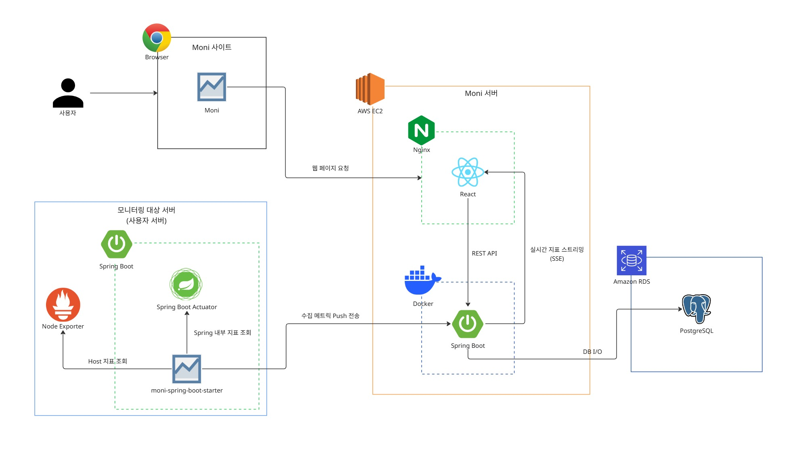

### 데이터 흐름
1. **모니터링 대상 서버 (Target Host)**
   - 타깃 서버에 배포된 `moni-spring-boot-starter`가 Spring Boot Actuator(애플리케이션 지표)와 Node Exporter(호스트 OS 지표)를 동시 조회합니다.
   - 수집된 지표를 주기적으로 Moni 백엔드 서버에 HTTPS POST 방식으로 전송합니다.
2. **Moni 서버 (AWS EC2)**
   - **Nginx**: 사용자 웹 브라우저의 정적 웹 페이지 요청을 수신 및 React 에셋을 서빙합니다.
   - **Docker / Spring Boot**: 클라이언트 라이브러리로부터 전송된 메트릭을 수신·인증(API Key)하고, Amazon RDS(PostgreSQL)에 적재합니다.
   - **실시간 지표 스트리밍 (SSE) & REST API**: 프론트엔드 대시보드와 통신하여 실시간 지표 스트리밍 및 과거 이력 조회를 처리합니다.
3. **사용자 브라우저**
   - 웹 브라우저를 통해 실시간 인프라 상태 및 애플리케이션 메트릭을 시각화된 차트로 확인 및 모니터링합니다.

---

## 주요 화면 및 기능

### 1. 인프라 관리 대시보드
등록된 인스턴스와 애플리케이션의 연결 상태 및 인프라 구성을 조회합니다.

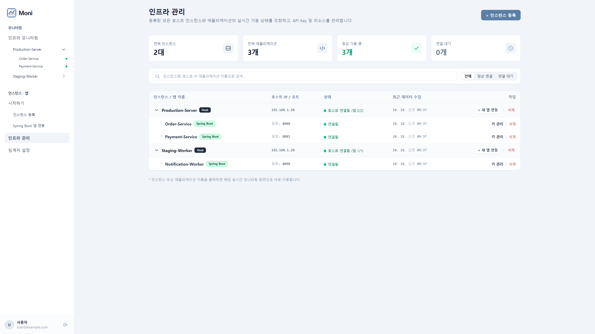

- 인스턴스 및 애플리케이션 가동 상태 요약
- 인스턴스-애플리케이션 계층 트리 및 연결 정보(IP, 포트, 최근 수집 시각) 확인

---

### 2. 인스턴스 실시간 모니터링
호스트 OS 레벨의 시스템 하드웨어 지표를 실시간 차트로 조회합니다.

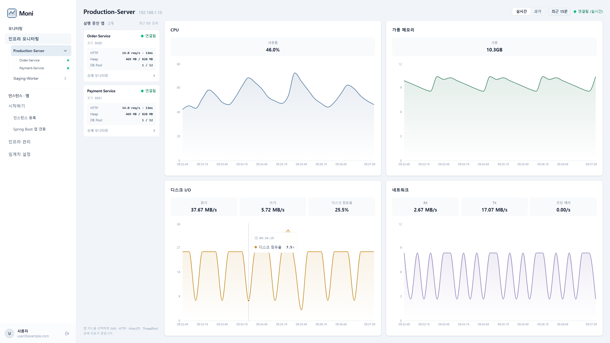

- **CPU & 메모리**: 전체 CPU 사용률, 가용 메모리 추이
- **디스크 & 네트워크**: 읽기/쓰기 속도, 디스크 점유율, 네트워크 송수신(RX/TX) 및 초당 에러율

---

### 3. 애플리케이션 실시간 모니터링
Spring Boot 애플리케이션의 세부 런타임 지표를 4가지 핵심 영역으로 실시간 모니터링합니다.

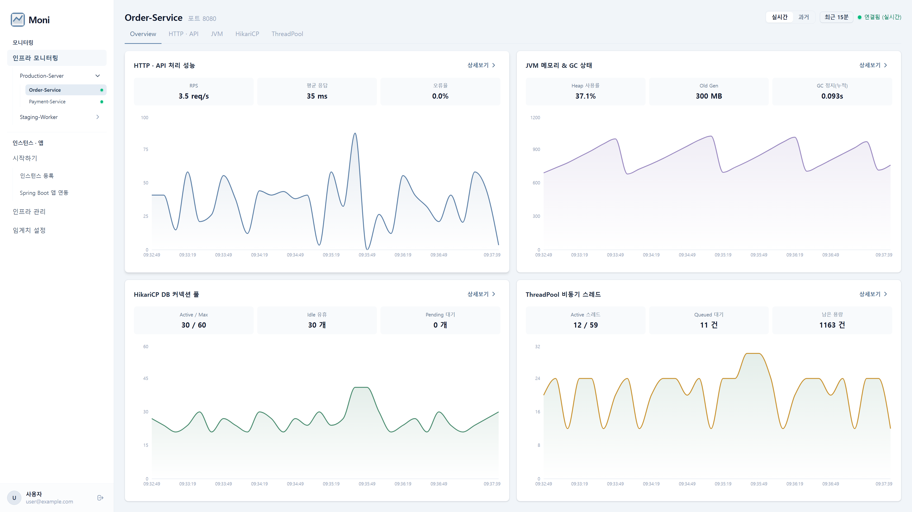

- **HTTP · API 처리 성능**: 초당 요청 수(RPS), 평균 응답 시간(ms), 오류율(%)
- **JVM 메모리 & GC**: Heap 사용률, Old Gen 용량, 누적 GC 정지 시간
- **HikariCP & ThreadPool**: DB 커넥션 풀(Active/Idle/Pending) 및 비동기 스레드 풀(Active/Queue)

---

### 4. 애플리케이션 과거 분석
일자별 타임라인을 통해 애플리케이션의 성능 변화 추이를 분석합니다.

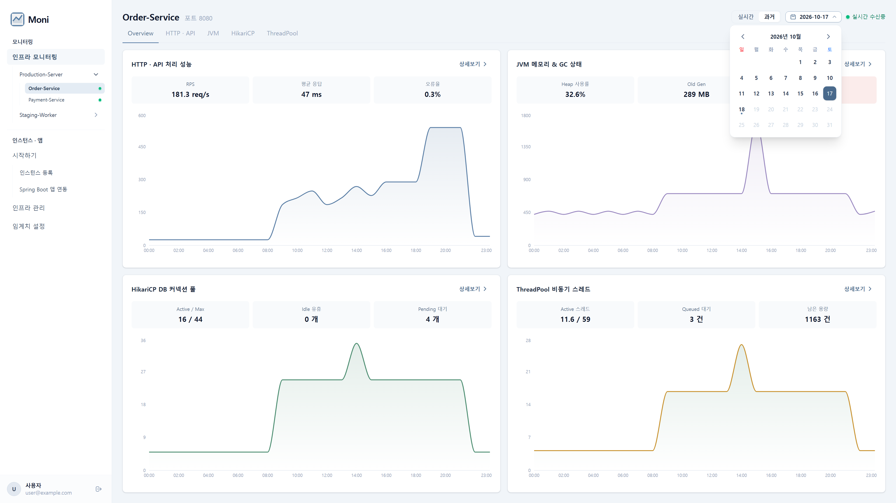

- 날짜 선택을 통한 과거 24시간 타임라인 지표 조회
- HTTP 처리 성능, JVM 메모리, 커넥션 풀 및 스레드 부하 추이 확인

---

### 5. 임계치 설정
시스템 리소스 과부하 상황을 사전에 인지할 수 있도록 지표별 경고(Warning) 및 심각(Critical) 임계치를 설정합니다.

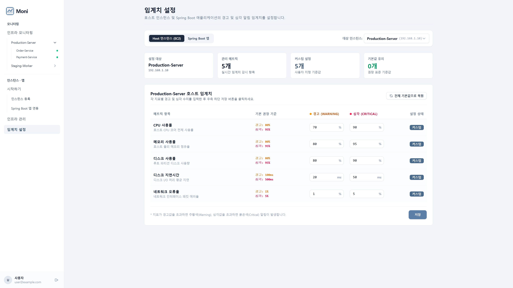

- CPU, 메모리, 디스크 사용률, 지연 시간, 네트워크 오류율 등의 기준값 설정
- 임계치 초과 시 대시보드 내 상태 알림 반영

---

### 6. 인스턴스 등록
새로운 서버 인스턴스를 관리 대상으로 등록하고 에이전트 설치 과정을 진행합니다.

| 1단계: 인스턴스 정보 입력 | 2단계: 에이전트 설치 스크립트 |
| :---: | :---: |
| 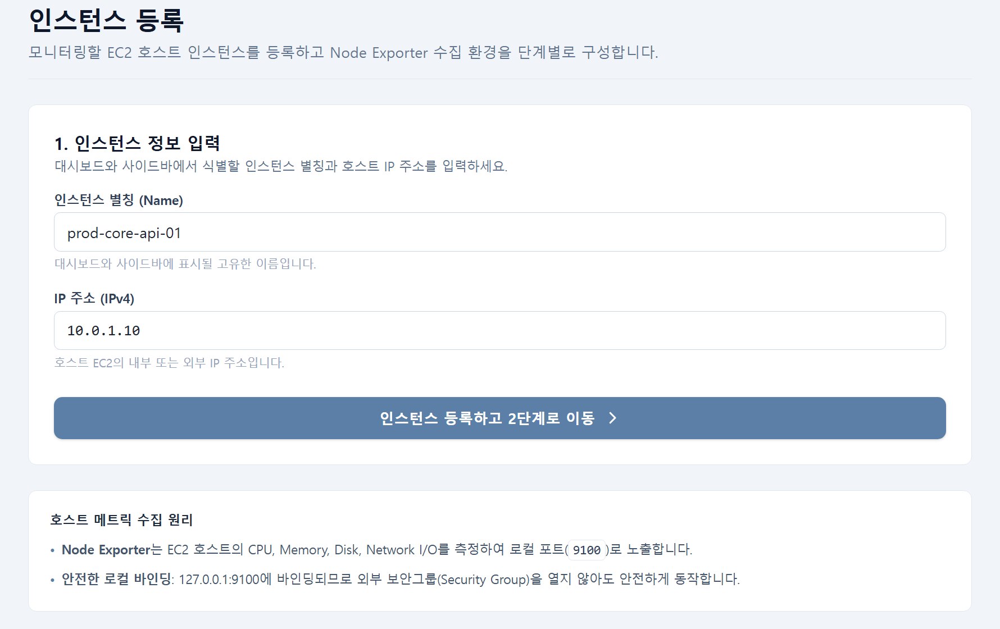 | 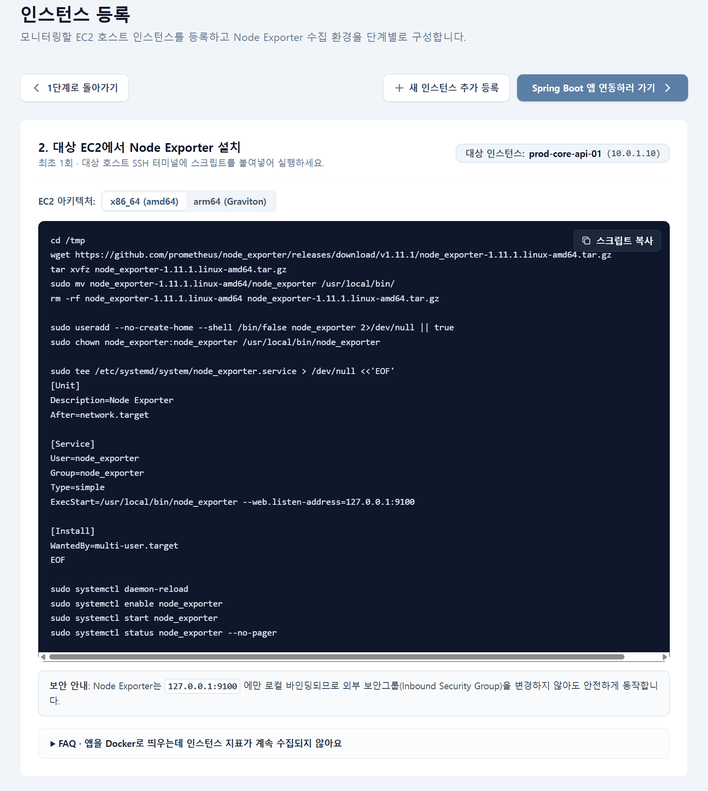 |
| 인스턴스 별칭, IP 주소 입력 | 호스트 서버에서 실행할 Node Exporter 설치 스크립트 안내 |

---

### 7. 애플리케이션 연동 및 API Key 관리
등록된 인스턴스에 모니터링 대상 Spring Boot 애플리케이션을 바인딩하고 인증용 API Key를 관리합니다.

| 1단계: 애플리케이션 정보 입력 | 2단계: 연동 가이드 및 API Key 발급 |
| :---: | :---: |
| 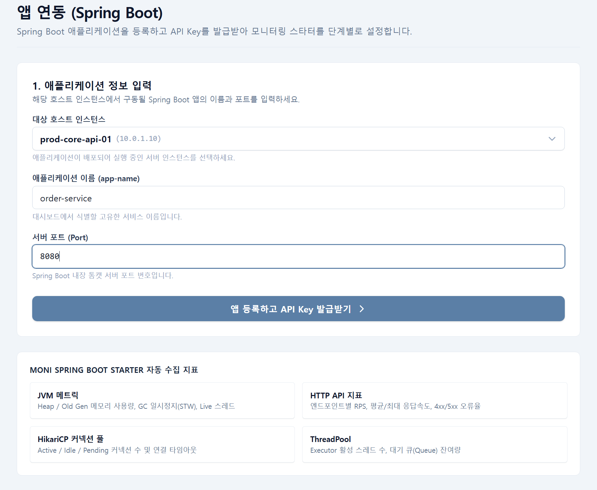 | 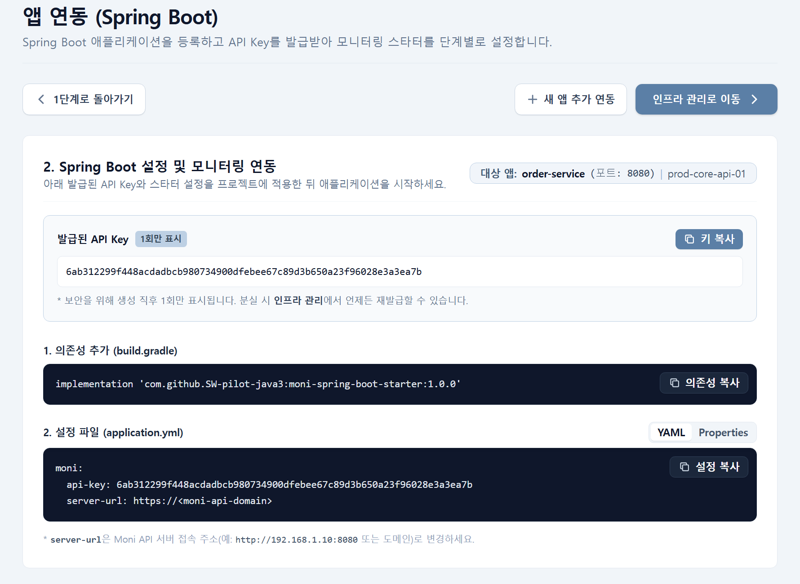 |
| 소속 인스턴스 선택, 앱 이름 및 서버 포트 설정 | 발급된 API Key 확인 및 `application.yaml` 설정 안내 |

#### API Key 관리 모달
| 기존 API Key 상태 확인 | API Key 재발급 |
| :---: | :---: |
| 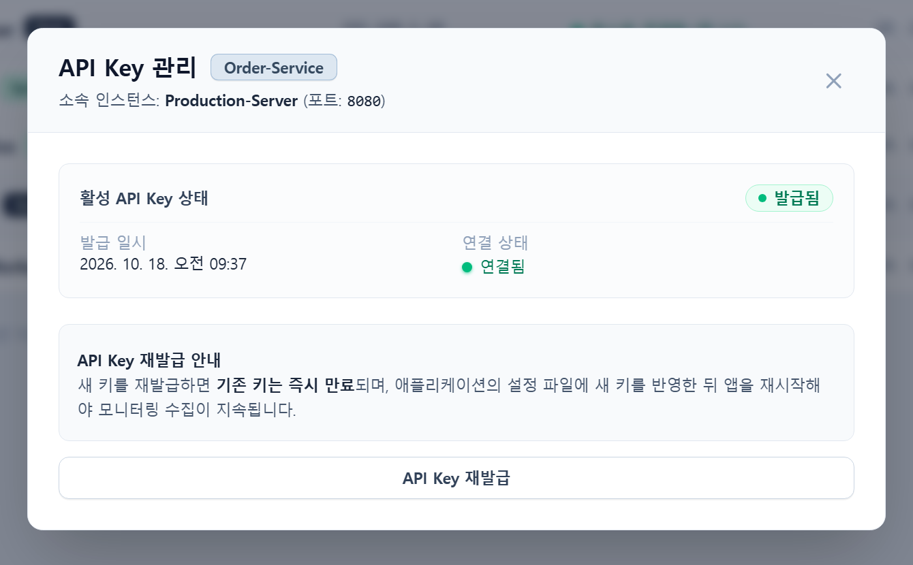 | 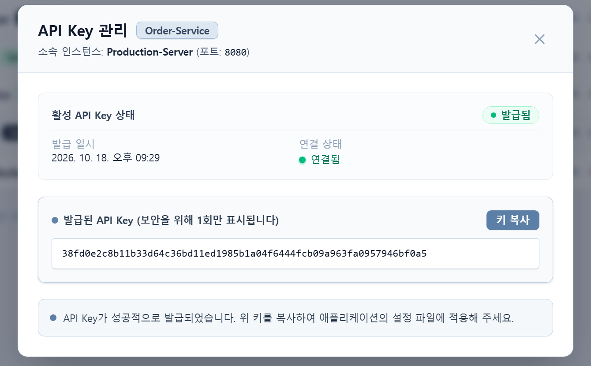 |
| 현재 키의 발급 일시 및 연결 상태 확인 | 재발급 시 기존 키 만료 처리 및 신규 키 1회 표시 |

---

## 클라이언트 라이브러리 연동

Spring Boot 애플리케이션에 `moni-spring-boot-starter`를 추가하여 메트릭 수집을 활성화합니다.

### 1. 의존성 추가 (Gradle)

```groovy
repositories {
    mavenCentral()
    maven { url 'https://jitpack.io' }
}

dependencies {
    implementation 'com.github.SW-pilot-java3:moni-spring-boot-starter:0.1.0'

    // 호스트 애플리케이션 필수 의존성
    implementation 'org.springframework.boot:spring-boot-starter-web'
    implementation 'org.springframework.boot:spring-boot-starter-actuator'
    implementation 'io.micrometer:micrometer-core'
}
```

### 2. 설정 (`application.yaml`)

```yaml
moni:
  api-key: ${MONI_API_KEY}                    # Moni에서 발급받은 API Key
  server-url: https://api.moni.example.com    # Moni 백엔드 Base URL
  interval: 10s                               # 수집 및 전송 주기 (기본값: 10초)
  collect-host-metrics: true                  # Node Exporter 지표 수집 여부 (기본값: true)
```

애플리케이션 기동 시 백그라운드 데몬 스레드가 설정된 주기(`interval`)마다 지표를 수집하여 `POST {server-url}/api/v1/metrics` 엔드포인트로 전송합니다.

---

## 기술 스택

### 백엔드 (Backend API)
- Java 21
- Spring Boot 4.1.0
- Spring Data JPA / Hibernate
- Spring Security, JJWT
- PostgreSQL
- Caffeine Cache
- SpringDoc OpenAPI (Swagger UI)

### 프론트엔드 (Frontend Web)
- React 19.2
- TypeScript
- Vite 8.2
- TailwindCSS v4
- Recharts 3.10
- React Router 7.18

### 클라이언트 라이브러리 (Starter)
- `moni-spring-boot-starter` (Spring Boot 3.5.x, 4.x 호환)

---

## 실행 방법

### 백엔드
```bash
cd api
./gradlew bootRun
```
- API 서버: `http://localhost:8080`
- Swagger 문서: `http://localhost:8080/swagger-ui.html`

### 프론트엔드
```bash
cd web
npm install
npm run dev
```
- Web 대시보드: `http://localhost:5173`